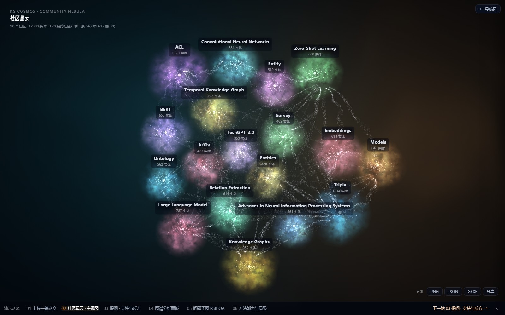

# KG Cosmos

**一句话**：把一篇综述 PDF 拆成实体与关系，建成可三维探索的知识图谱，并给每层抽取打一个可复核的质量分。



> 主视图 `web/kg-nebula.html`：18 个 Louvain 社区、120 条跨社区纤维（`web/kg-data/filaments.json`
> 的 `meta` 记录 12090 个节点）。

---

## 为什么不是又一个 RAG demo

RAG demo 的验收标准通常是「问几个问题、回答看着像」。这个项目把验收换成可复核的数：

1. **每层有独立金标准。** 实体、端点、谓词、三元组、证据各自判各层的，不共用一份总金标。
2. **报 PPV / κ，不报笼统准确率。** 「判通过的边里有多少真成立」是 PPV（49.7%）；
   与人判一致的程度是 Cohen's κ（0.236）。这两个数比「accuracy 95%」有用得多，也难看得多。
3. **负结果照实写。** 关系层多人标注的 Krippendorff α 在双口径下都是负的
   （实体层 0.2312 / 0.2880，关系层 −0.0119 / −0.1465），留一法验证后仍为负。
   证据指向「关系抽取在这类综述上本身就难以主观标注」，不是「再调一轮就好了」。
4. **平凡基线必须打平或被打败。** 15 类谓词 argmax 与抽取器标注的一致率 25.73%，
   而「全预测 `RELATED_TO`」的平凡基线是 22.00% —— 只差 3.73pp。所以 L4b 不是准确率。

## 六层分别测什么

| 层 | 测什么 | 判据 | 实测 |
|---|---|---|---|
| L1 | 词形归一 | 实体名的归一化形式是否出现在 `evidence[0].text` | 93.6%（全口径 19463/20785）；抽取口径 92.0% |
| L2 | 实体聚类 | 三层合并（规则归一 / 形态模糊匹配 / 缩写抽取）的合并组数 | 585 组（只计数，未逐组判对错） |
| L3 | 关系端点 | 两端是否都是独立抽取出来的节点 | 70.1%（抽取口径）/ 96.5%（闭合口径） |
| L4a | 关系谓词 | 谓词是否落在本体 15 类内（**只判在不在**） | 99.5% |
| L4b | 谓词一致性 | 15 类模板 argmax vs 抽取器标注 | 25.73%（平凡基线 22.00%） |
| L5 | 三元组验证 | 本地 NLI 判别器判「被原文支持」 | 通过率 63.6%，**PPV 仅 49.7%** |
| L6 | 证据完整性 | 每条边是否带页级引文 | 100% |

> L3 必须报两个口径：闭合口径含 4304 个「从边反建」的节点，等于用边的产物去证明边的端点齐全，
> 拿它当质量分是粉饰。L1 同理 —— 那段 `evidence` 就是该实体被抽出时的 chunk 原文，
> 对独立抽取的节点是定义恒等，它实际度量的是词形归一一致性，**不是「实体存在性」**。

## 快速开始

依赖：Python 3.10+；前端无构建链（Three.js / pdf.js 已本地化，断网可用）。

```bash
pip install -r requirements.lock
python tools/serve.py            # 前置检查（数据/端口/依赖/Neo4j）后起服务
# 打开 http://127.0.0.1:8000/
python tools/serve.py --static   # 只起纯静态站，零 Python 依赖
```

数据准备（本仓库是精简版，**不含**源项目 `data/` 那 287 MB 的全量评测快照与语料 PDF）：

- 3D 主视图开箱可用：`web/kg-data/filaments.json`、`community-summaries.json`、`analytics.json`
- 要做 60 社区概览层，需自备 PDF 走上传流程，或按 `tools/build_nebula_data.py` 重建 `nebula.json`
- LLM 抽取需 `DEEPSEEK_API_KEY`（云端）或本机 Ollama；缺了 `serve.py` 会明说，不会假装跑过

## 测试

2026-11-27 在本精简树实测（`python -m pytest -q`，Python 3.13.0 / pytest 9.0.2，Windows）：

```text
# 设 PYTHONUTF8=1
395 passed, 25 skipped, 27 subtests passed in 13.18s

# 不设 PYTHONUTF8（Windows 默认 GBK/cp936）
1 failed, 394 passed, 25 skipped, 27 subtests passed in 11.72s
```

**25 条 skip 全部因为精简树不含数据**，不是测试坏了：`data/corpus/graphs`（5 条）、
语料 PDF（5 条）、`web/kg-data/nebula.json`（6 条）、Neo4j 未启动（4 条）、
`data/quality/archive`（1 条）、`data/ad690dfb/2506.09566v1.pdf`（2 条）、慢测试（1 条）、
方向字面量比对已废弃（1 条）。把 [REBUILD.md](REBUILD.md) 里移出的数据按原路径放回去，
这些用例会由 skip 转 pass。

**不设 PYTHONUTF8 时唯一的失败**是 `test_metric_archive.py::test_write_archives_exactly_one_new_copy`：
`tools/metric_provenance.py` 打印 `📦`(U+1F4E6)，cp936 控制台下 `UnicodeEncodeError`
让子进程退出码变 1，而断言的是 `returncode == 0`。**修法：`chcp 65001`，或设
`PYTHONUTF8=1` 后重跑**。源项目完整树里是 4 条同类失败（另有 `tools/apply_edit_plan.py`
打印 `⚠️`/`✅`/`❌` 的 3 条），精简树删掉 `data/corpus/` 后那 3 条的用例变为 skip，只剩 1 条。
定位清单见 [FIX_TESTS.md](FIX_TESTS.md)。

## 评测结果与局限

| 数字 | 值 | 这意味着什么 |
|---|---|---|
| L5 判别器 PPV | **49.7%** | 判通过的边里约一半不被原文支持，假阳性 13960 比真阳性 13778 还多。**「被原文支持」这一层不能直接当事实用。** |
| L5 与人判 κ | **0.236** | 一致性偏低；而零成本的 `hit=both` 字符串规则 κ=0.407，比这个花代价的判别器更接近人判。阈值 0.5→0.8 只把 PPV 抬到 56.7%：它是数量旋钮，不是质量旋钮。 |
| L4b 谓词一致率 | **25.73%** | 只比平凡基线 22.00% 高 3.73pp。**谓词层基本不可信，别拿它做推理。** |
| L1 词形归一 | 93.6% | 可用，但它测的是「名字写对了没有」，不是「实体找对了没有」。 |
| L6 证据完整性 | 100% | 可用：每条边都能跳回页码。这是全项目最稳的一层。 |

**哪层能用**：L1（词形归一）、L6（页级证据）、L3 抽取口径 70.1%（端点是否独立抽出）可以当工程指标。
**哪层不能用**：L4b（谓词选择）、L5 的「被原文支持」判定 —— 直接引用会传播错误。
**L2 只有合并组数、没有对错判据**，不能称作质量分。

其他限度：

- L5 的支持率 40.0% / PPV 49.7% 来自 200 条分层抽样的两人盲判，样本不大；κ=0.236 本身也说明人判并不稳固。
- 另有 L7（方向校验：15 类里仅 3 类有方向指针，`CREATED_BY` 92.4% 还含「用同一套规则改完再检查」的循环论证）
  与 L9（端点召回 86.2% / 关系召回 42.9%，**分母仅 29 实体 / 7 段 / 42 条三元组**）。
  两层都不在六层内，不要当成六层的补充分数。
- 本文所有数字都能在 `docs/` 或 `data/quality/` 找到出处；找不到出处的数字（例如外部资料里的
  「634 节点」）一律不写。

## 仓库说明

精简版：移出 `data/quality/baseline/`、`data/quality/graphs-published-in/`、
`data/quality/relation-verify-all.json` 等评测全量快照与语料 PDF。干净树实测
**537 个文件 / 13.56 MB**（首次提交的 pack **3.66 MiB**，即 clone 实际要下载的量），
重建步骤见 [REBUILD.md](REBUILD.md)。

**`data/` 只剩 100 个文件 / 4.05 MB**：`data/quality/` 90 个（六层指标、金标、L5 人工复核样本、
`edit-plans/` 5 个编辑计划）、`data/gold/` 7 个金标准、`data/external/` 2 个外部对照、
`data/ad690dfb/graph.json`（演示图，`/api/qa` 端点测试与 `web/ask.html` 的默认图）。
全量评测数据、语料 PDF 与 LoRA 蒸馏中间产物不在本仓库，**需自行生成，见 [RUNBOOK.md](RUNBOOK.md)**。

## 许可

MIT，见 [LICENSE](LICENSE)。
